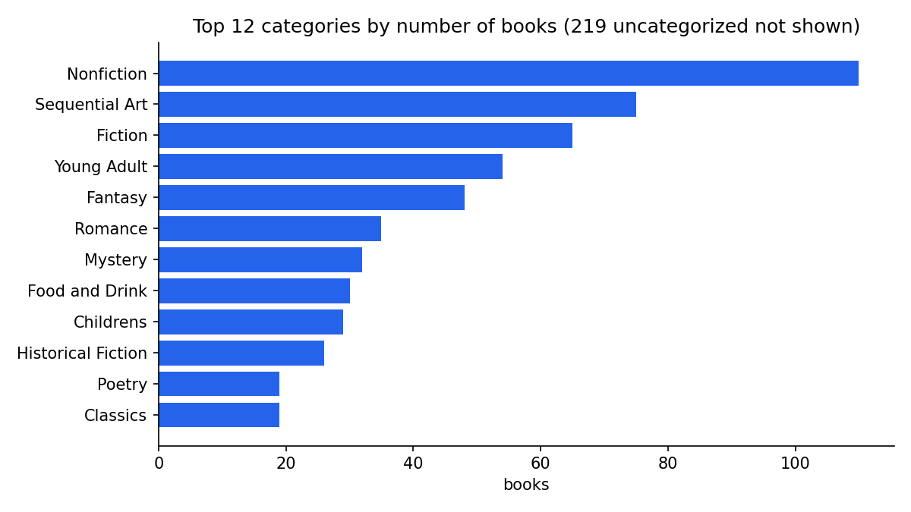

# Book Catalogue Scraper → Clean Data → Report

A small end-to-end data project: scrape a full online catalogue, clean and validate the data with pandas,
and deliver it the way a client actually uses it: CSV, a formatted Excel workbook, charts and a one-page
HTML report.

The source is [books.toscrape.com](https://books.toscrape.com), a public sandbox site built for scraping
practice, so the project can be run and checked by anyone.



## Result

| | |
|---|---|
| Books collected | 1,000 (all 50 catalogue pages + every product page) |
| Categories | 48 real categories (+ `Uncategorized`) |
| Failed downloads / duplicates / price-tax mismatches | 0 / 0 / 0 |
| Data issue found and fixed | 219 books filed under placeholder categories ("Default", "Add a comment") → marked `Uncategorized` and reported |
| Runtime | ~5 minutes at a polite 0.3 s between requests |

## What it does

1. **Scrape** (`scraper.py`): `requests` + `BeautifulSoup`. Walks the catalogue pages, then visits each
   product page for details that only exist there (UPC, exact stock count, category, tax, reviews).
   Polite by design: clear User-Agent, a shared rate limit across threads, automatic retries with back-off.
   Raw values are saved untouched to `data/raw_books.jsonl`, so cleaning can be re-run without re-scraping.
2. **Clean & validate** (`clean.py`): `pandas`. Prices like `£51.77` (or mis-encoded `£51.77`) → numbers,
   star ratings `"Three"` → `3`, `"In stock (22 available)"` → `22`. Removes duplicates by UPC, checks that
   price + tax = price incl. tax, flags placeholder categories, and writes a data-quality report.
3. **Deliver** (`report.py`):
   - `output/books.csv`: UTF-8 with BOM, opens cleanly in Excel
   - `output/books.xlsx`: three sheets (Books, By category, Data quality) with frozen headers, filters and sized columns
   - `output/charts/*.png`: category, price-distribution and price-by-rating charts
   - `output/report.html`: responsive one-page report with KPIs, charts and tables

## Run it

```bash
python -m venv .venv
.venv/Scripts/activate          # Windows  (macOS/Linux: source .venv/bin/activate)
pip install -r requirements.txt
python run.py                   # full catalogue
python run.py --pages 3         # quick sample
python run.py --skip-scrape     # rebuild outputs from the saved raw file
python -m unittest discover -s tests
```

## Adapting it to your site

The structure stays the same for most catalogue-style sites: listing pages → detail pages → typed table.
What changes is the CSS selectors in `scraper.py` and the parsing rules in `clean.py`. Before scraping a
real site I check its terms of use and robots.txt, prefer an official API when there is one, keep the
request rate low, and do not collect personal data.

**Stack:** Python 3.12 · requests · BeautifulSoup · pandas · openpyxl · matplotlib
